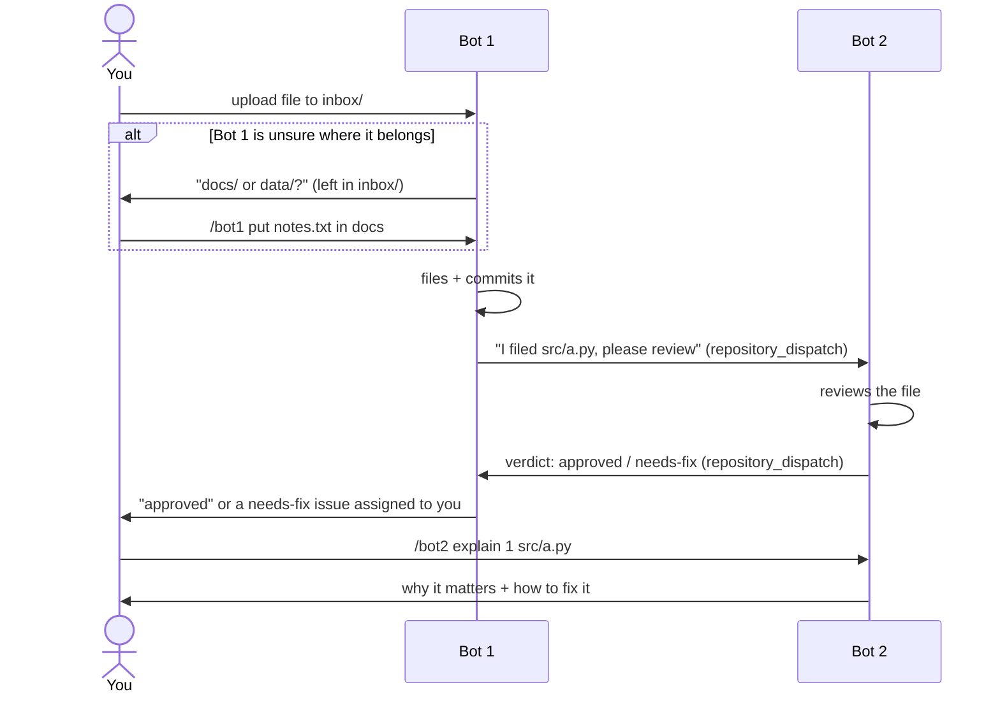

# Bot 1 and Bot 2 as teammates

Two bots that work like members of your team: each has its own job, you can talk to both of them, and they talk to each other.

| Teammate | Job |
|---|---|
| **Bot 1** 📂 | Files uploads from `inbox/`, moves/deletes/lists files, asks you when unsure, posts activity and a weekly digest |
| **Bot 2** 🔍 | Reviews every pull request and every code file Bot 1 files, explains findings, warns when project code changes without tests |

## How the conversation works



Everything is visible as comments in the **📋 Repo Activity Log (Bot 1)** issue, so your mentor can read the whole conversation later. Each bot comment starts with a hidden marker (`<!-- bot-msg from=bot1 to=bot2 type=review_request ... -->`) saying who is talking to whom.

## Talking to them on GitHub

Comment on any issue or pull request. Use the **slash form**: `@bot1` would also ping a real GitHub user called bot1 (`@bot1` still works if you prefer it).

| Command | Does |
|---|---|
| `/bot1 help` · `/bot2 help` | each bot says what it can do |
| `/bot1 list [folder]` | list files |
| `/bot1 move OLD NEW` | move a file (never overwrites) |
| `/bot1 delete PATH` then `... confirm` | delete, only after you confirm |
| `/bot1 put FILE in FOLDER` | answer Bot 1's "where does this go?" question |
| `/bot1 status` | what is waiting in `inbox/` |
| `/bot1 review PATH` | ask Bot 2 to review a file |
| `/bot2 review PR 3` | review PR #3 (or just `/bot2 review` inside a PR) |
| `/bot2 review PATH` | review one file in the repo |
| `/bot2 explain N [PATH]` | explain finding N |

Only the owner, members and collaborators can give commands. Anyone else gets a polite refusal, so strangers can't make Bot 1 delete files.

## Talking to them in the terminal

```bash
export GITHUB_TOKEN=...   GITHUB_REPO=owner/name      # or keep them in .env
python -m team chat
```

You are talking to Bot 1 first. Type `bot2` to switch, or start a line with `/bot2 ...` to talk to Bot 2 for one message. In the terminal `/bot2 review some/local/file.py` reviews a file on your computer. `/quit` leaves.
(The older `python -m bot1` menu still works.)

## What the bots do on their own

- **Bot 1 asks questions.** For a file type it can't place, it leaves the file in `inbox/` and asks you (once, no nagging).
- **Bot 1 hands code to Bot 2.** Every code file it files (`.py .js .ts .java .c .cpp .cu .sh ...`) is sent for review. On `needs-fix`, Bot 1 opens a `needs-fix` issue assigned to you.
- **Weekly digest (Mondays).** Bot 1 summarises the week's commits. Bot 2 warns if `agents/`, `tools/` or `llm/` changed with no test changes.
- **Introductions.** Actions tab → *Team - Weekly digest and introductions* → Run workflow → `intro`.

## Setup (once)

1. Commit these changes to your default branch.
2. Settings → Actions → General → *Workflow permissions* → **Read and write permissions**.
3. Optional secrets: `GEMINI_API_KEY` (Bot 2 AI review), `ANTHROPIC_API_KEY` (Bot 1 smarter placement).
4. Run the *intro* task once so both bots introduce themselves.

## Demo script for your mentor (about 3 minutes)

1. Run the **intro** task. Open the Activity Log issue: both bots introduce themselves.
2. Upload `mystery.zzz` to `inbox/`. Bot 1 asks where it goes. Reply `/bot1 put mystery.zzz in misc`.
3. Upload `demo_bad.py` (e.g. use `Bot2/src/auth.py`) to `inbox/`. Watch the thread: Bot 1 files it → asks Bot 2 → Bot 2 replies `needs-fix` → Bot 1 opens a `needs-fix` issue and pings you.
4. Comment `/bot2 explain 1 src/auth.py` and read the explanation.
5. Comment `/bot1 delete src/auth.py` and show it waits for `confirm`.
6. Open a pull request and show Bot 2's single review comment updating in place.
7. In a terminal: `python -m team chat`, then `/bot2 review Bot2/src/auth.py`.

## Design notes (for the viva)

- **Why `repository_dispatch`?** Comments made with the built-in `GITHUB_TOKEN` don't trigger other workflows (to prevent loops), but `repository_dispatch` events do. That's how one bot wakes the other without a personal token.
- **Why default-branch code?** Comment and dispatch workflows run the trusted default-branch code and fetch PR contents through the API, so a malicious PR can't run code with write permissions.
- **Loop safety.** Bots ignore comments made by bots and comments carrying a `bot-msg` marker.
- **Safety stays in Bot 1.** All moves/deletes go through the existing path validation (no traversal, `.git`, `.github`, `bot1/` protected) and deletes need confirmation.
